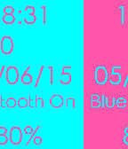

<!-- Generated by scripts/update_app_directory.py: do not edit by hand -->
[← All Pebble Developers](../developers.md)

# Spitzkopf

*2 watchfaces · Last updated 2026-10-11 · [About these lists](../about-app-lists.md)*

Links: [Pebble App Store](https://apps.repebble.com/apps/dev/spitzkopf_54a56dff5d5a9130d700009e) · [GitHub (Spitzkopf)](https://github.com/Spitzkopf)

<button type="button" data-filter="all" aria-pressed="true">All 2</button><button type="button" data-filter="watchface" aria-pressed="false">Watchfaces 2</button><button type="button" data-filter="watchapp" aria-pressed="false" disabled>Apps 0</button>

<label class="dev-sort">Sort by <select><option value="updated">Recently updated</option><option value="released">Newest release</option><option value="title">A–Z</option></select></label>

<h2 class="app-name" id="app-5571bfe2fdb261eb7600003d"><a href="https://apps.repebble.com/5571bfe2fdb261eb7600003d">Wrapped</a> v1.0</h2>
<a class="app-source" href="https://github.com/Spitzkopf/WrapWatchface" title="Source code" data-search-exclude>View source</a>

Watchface

No licence Released 2015-06-05 Updated 2015-06-05

Runs on: Time 2, Pebble 2 Duo, Pebble 2, Time, Classic

Each element of the watchface is displayed in a 2 color row. Row elements changed with a nifty little slide-in-slide-out effect.

<h2 class="app-name" id="app-5544b65f946ce2c0c500004d"><a href="https://apps.repebble.com/5544b65f946ce2c0c500004d">Caesar Nero</a> v1.0</h2>
<a class="app-source" href="https://github.com/Spitzkopf/Pebble-TrueToCaesar" title="Source code" data-search-exclude>View source</a>

Watchface

No licence Released 2015-05-02 Updated 2015-05-02

Runs on: Time 2, Pebble 2 Duo, Pebble 2, Time, Classic

*A simple roman numerals watchface *Features the hour and minutes, battery status and bluetooth status *A small banner with Nero&#x27;s last words *The background image inverts to reflect the current…

