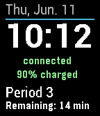

<!-- Generated by scripts/update_app_directory.py: do not edit by hand -->
[← All Pebble Developers](../developers.md)

# Spooner

*1 watchface · Last updated 2026-10-12 · [About these lists](../about-app-lists.md)*

Links: [Pebble App Store](https://apps.repebble.com/apps/dev/spooner_5337603457418e3bd60000d6) · [GitHub (cmspooner)](https://github.com/cmspooner)

<h2 class="app-name" id="app-54932ab374e207c3a9000112"><a href="https://apps.repebble.com/54932ab374e207c3a9000112">Kearsarge Time</a> v3.5</h2>
<a class="app-source" href="https://github.com/cmspooner/krhs-time" title="Source code" data-search-exclude>View source</a>

Watchface

No licence Released 2014-12-18 Updated 2016-09-14

Runs on: Round 2, Time 2, Pebble 2 Duo, Pebble 2, Time Round, Time, Classic

Watchface that displays the current period at Kearsarge Regional High School in color.

