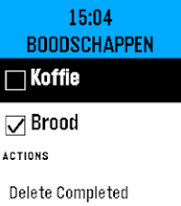

<!-- Generated by scripts/update_app_directory.py: do not edit by hand -->
[← All Pebble Developers](../developers.md)

# Spud

*1 app · Last updated 2026-10-12 · [About these lists](../about-app-lists.md)*

Links: [Pebble App Store](https://apps.repebble.com/apps/dev/spud_a8592d0ab4efe177a57b17ea) · [GitHub (spudje)](https://github.com/spudje)

<h2 class="app-name" id="app-bdac83d64d7a4733a699b5a1"><a href="https://apps.repebble.com/bdac83d64d7a4733a699b5a1">HASS To Do List</a> v1.0.0</h2>
<a class="app-source" href="https://github.com/spudje/PebbleHassToDo" title="Source code" data-search-exclude>View source</a>

App

Released 2026-06-14 Updated 2026-06-14

Runs on: Round 2, Time 2, Pebble 2 Duo, Pebble 2, Time Round, Time, Classic

HASS To Do List is a simple watchapp that lists to do items of a single Home Assistant Local To Do List (https://www.home-assistant.io/integrations/local_todo/). You can complete items on the to…

