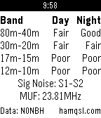

<!-- Generated by scripts/update_app_directory.py: do not edit by hand -->
[← All Pebble Developers](../developers.md)

# Squirrelware

*1 app · Last updated 2026-10-12 · [About these lists](../about-app-lists.md)*

Links: [Pebble App Store](https://apps.repebble.com/apps/dev/squirrelware_531a67d0eb7a77b7610008ca) · [GitHub (keisisqrl)](https://github.com/keisisqrl) · [Website (hamqsl.com)](http://www.hamqsl.com/solar.html)

<h2 class="app-name" id="app-56194668aca3bb54ae00008d"><a href="https://apps.repebble.com/56194668aca3bb54ae00008d">HF Band Conditions</a> v1.0</h2>
<a class="app-source" href="https://github.com/keisisqrl/pebble-band-conditions" title="Source code" data-search-exclude>View source</a>

App

Released 2015-10-10 Updated 2015-10-10

Runs on: Time 2, Pebble 2 Duo, Pebble 2, Time, Classic

Uses data from NONBH&#x27;s solar weather information at http://hamqsl.com/solar.html to deliver band conditions, signal noise, and MUF right to your watch. Icon from NASA SDO

