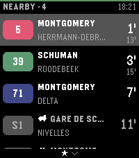

<!-- Generated by scripts/update_app_directory.py: do not edit by hand -->
[← All Pebble Developers](../developers.md)

# Sreedev Kodichath

*1 app · Last updated 2026-10-12 · [About these lists](../about-app-lists.md)*

Links: [Pebble App Store](https://apps.repebble.com/apps/dev/sreedev-kodichath_80f9fee74b865c854d660952) · [Website (sree.dev)](https://sree.dev)

<h2 class="app-name" id="app-ceaa036bfc5543f6b0873247"><a href="https://apps.repebble.com/ceaa036bfc5543f6b0873247">Stibble</a> v2.7.1</h2>
<a class="app-source" href="https://git.devtechnica.com/pebbletechnica/stibble" title="Source code" data-search-exclude>View source</a>

App

Released 2026-08-20 Updated 2026-08-28

Runs on: Time 2

Stibble shows live STIB-MIVB departures on your Pebble Time 2. It covers the bus, tram, and metro network of Brussels. The app finds the stops nearest to you. Each stop shows its lines. Each line…

