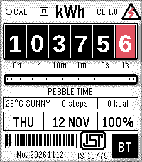

<!-- Generated by scripts/update_app_directory.py: do not edit by hand -->
[← All Pebble Developers](../developers.md)

# Srivatsan Balaji

*1 watchface · Last updated 2026-11-23 · [About these lists](../about-app-lists.md)*

Links: [Pebble App Store](https://apps.repebble.com/apps/dev/srivatsan-balaji_999e43b462a454979127612d) · [GitHub (kryptocodes)](https://github.com/kryptocodes)

<h2 class="app-name" id="app-f75bd2d2b19443f8ae49553c"><a href="https://apps.repebble.com/f75bd2d2b19443f8ae49553c">Energy Meter</a> v1.1.1</h2>
<a class="app-source" href="https://github.com/kryptocodes/pebble-energy-meter" title="Source code" data-search-exclude>View source</a>

Watchface

MIT Released 2026-11-12 Updated 2026-11-19

Runs on: Round 2, Time 2, Pebble 2 Duo, Pebble 2, Time Round, Time

A watchface modelled on the electricity meter at home. Six register drums read HH MM SS, the meter disc spins faster as you move, and the CAL LED blinks every second. The nameplate shows weather…

