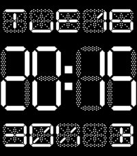
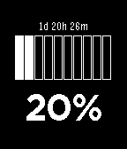

<!-- Generated by scripts/update_app_directory.py: do not edit by hand -->
[← All Pebble Developers](../developers.md)

# Staffan Thomen

*2 watchfaces · Last updated 2026-10-12 · [About these lists](../about-app-lists.md)*

Links: [Pebble App Store](https://apps.repebble.com/apps/dev/staffan-thomen_531b2c732a95cc1a1b000410)

<button type="button" data-filter="all" aria-pressed="true">All 2</button><button type="button" data-filter="watchface" aria-pressed="false">Watchfaces 2</button><button type="button" data-filter="watchapp" aria-pressed="false" disabled>Apps 0</button>

<label class="dev-sort">Sort by <select><option value="updated">Recently updated</option><option value="released">Newest release</option><option value="title">A–Z</option></select></label>

<h2 class="app-name" id="app-549077e0cd117d6d720000f5"><a href="https://apps.repebble.com/549077e0cd117d6d720000f5">7 Seg</a> v1.8</h2>
<a class="app-source" href="http://mercurial.shangtai.net/repo/7-seg/" title="Source code" data-search-exclude>View source</a>

Watchface

Released 2014-12-16 Updated 2017-08-10

Runs on: Time 2, Pebble 2 Duo, Pebble 2, Time, Classic

Shows the time in 7-segment retro style. Day (using the new pebble localized strings), date, battery level and bluetooth status in 14-segment text. Optionally invert the screen, remove the…

<h2 class="app-name" id="app-546a3a6c15309c28940000c2"><a href="https://apps.repebble.com/546a3a6c15309c28940000c2">Simple Battery Meter</a> v1.13</h2>
<a class="app-source" href="http://mercurial.shangtai.net/repo/simple-battery/" title="Source code" data-search-exclude>View source</a>

Watchface

Released 2014-11-17 Updated 2015-11-09

Runs on: Time 2, Pebble 2 Duo, Pebble 2, Time, Classic

A simple battery meter watchface that shows the percentage and boxes representing the current battery level. Features: - Fancy start animation - Battery lifetime estimate Please note that…

