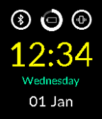
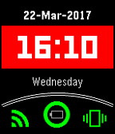
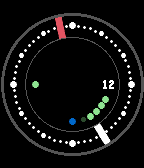

<!-- Generated by scripts/update_app_directory.py: do not edit by hand -->
[← All Pebble Developers](../developers.md)

# stark-dev

*4 watchfaces · Last updated 2026-10-12 · [About these lists](../about-app-lists.md)*

Links: [Rebble App Store](https://apps.rebble.io/en_US/developer/583d7ae300355a2f3a00056e/1) · [GitHub (stark-dev)](https://github.com/stark-dev)

<button type="button" data-filter="all" aria-pressed="true">All 4</button><button type="button" data-filter="watchface" aria-pressed="false">Watchfaces 4</button><button type="button" data-filter="watchapp" aria-pressed="false" disabled>Apps 0</button>

<label class="dev-sort">Sort by <select><option value="updated">Recently updated</option><option value="released">Newest release</option><option value="title">A–Z</option></select></label>

<h2 class="app-name" id="app-58d56b610dfc3252f4000500"><a href="https://apps.rebble.io/en_US/application/58d56b610dfc3252f4000500">Q-Time</a> v1.1</h2>
<a class="app-source" href="https://github.com/stark-dev/Q-Time" title="Source code" data-search-exclude>View source</a>

Watchface

Released 2017-03-24 Updated 2017-05-05 Rebble App Store

Runs on: Time 2, Time

Simple and clean watchface, inspired by Fossil Q style smartwatch. It shows date and weekday, battery status, quiet mode and bluetooth connection status. UPDATE: Version 1.1 allows to set colours…

<h2 class="app-name" id="app-586a7c542ee431238100037b"><a href="https://apps.rebble.io/en_US/application/586a7c542ee431238100037b">Time Square</a> v0.3</h2>
<a class="app-source" href="https://github.com/stark-dev/Time-Square" title="Source code" data-search-exclude>View source</a>

Watchface

Released 2017-01-02 Updated 2017-03-22 Rebble App Store

Runs on: Time 2, Time

Square watchface with time, date and weekday. It also includes battery, connection and vibration info. Battery circle represents the percentage of charge remaining. When battery reaches 20% the…

<h2 class="app-name" id="app-584de168ce45dc2706000242"><a href="https://apps.rebble.io/en_US/application/584de168ce45dc2706000242">ZWF</a> v0.5</h2>
<a class="app-source" href="https://github.com/stark-dev/ZWF" title="Source code" data-search-exclude>View source</a>

Watchface

Released 2016-12-11 Updated 2016-12-14 Rebble App Store

Runs on: Round 2, Time 2, Time Round, Time

Simple watchface. Shows date, bluetooth status, quiet mode and battery level. Hours: white; Minutes: red; Bluetooth dot is blue when connected, red when disconnected. The leftmost dot is red when…

<h2 class="app-name" id="app-584dfc2f77324baac00003de"><a href="https://apps.rebble.io/en_US/application/584dfc2f77324baac00003de">ORBIT</a> v0.3</h2>
<a class="app-source" href="https://github.com/stark-dev/ORBIT-WF" title="Source code" data-search-exclude>View source</a>

Watchface

Released 2016-12-12 Updated 2016-12-12 Rebble App Store

Runs on: Round 2, Time 2, Time Round, Time

Simple watchface, shows date, battery status, bluetooth and quiet mode. Hands are similar to planets Hours: red; Minutes: white; Bluetooth dot is blue when connected, red when disconnected. The…

