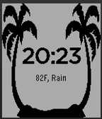

<!-- Generated by scripts/update_app_directory.py: do not edit by hand -->
[← All Pebble Developers](../developers.md)

# Starscreams Ghost

*1 watchface · Last updated 2026-10-11 · [About these lists](../about-app-lists.md)*

Links: [Pebble App Store](https://apps.repebble.com/apps/dev/starscreams-ghost_549c6114ad219e8b11000718)

<h2 class="app-name" id="app-559f0f11479e45928f000080"><a href="https://apps.repebble.com/559f0f11479e45928f000080">Palm Trees</a> v1.0</h2>
<a class="app-source" href="https://cloudpebble.net/ide/project/209035" title="Source code" data-search-exclude>View source</a>

Watchface

Released 2015-07-10 Updated 2015-07-10

Runs on: Time 2, Pebble 2 Duo, Pebble 2, Time, Classic

Watchface features 2 palm trees with the current time and temperature based on location.

