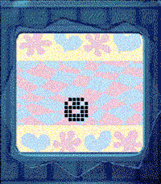
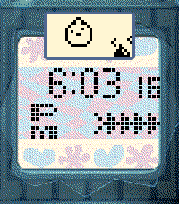
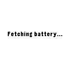
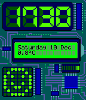

<!-- Generated by scripts/update_app_directory.py: do not edit by hand -->
[← All Pebble Developers](../developers.md)

# Stefan Bauwens

*2 watchfaces and 2 apps · Last updated 2026-10-12 · [About these lists](../about-app-lists.md)*

Links: [Pebble App Store](https://apps.repebble.com/apps/dev/stefan-bauwens_599dee8a461a8d18890012bc) · [GitHub (StefanBauwens)](https://github.com/StefanBauwens)

<button type="button" data-filter="all" aria-pressed="true">All 4</button><button type="button" data-filter="watchface" aria-pressed="false">Watchfaces 2</button><button type="button" data-filter="watchapp" aria-pressed="false">Apps 2</button>

<label class="dev-sort">Sort by <select><option value="updated">Recently updated</option><option value="released">Newest release</option><option value="title">A–Z</option></select></label>

<h2 class="app-name" id="app-216a0f62c6e44aac8f725e68"><a href="https://apps.repebble.com/216a0f62c6e44aac8f725e68">Tamagotchi Emulator</a> v1.5.1</h2>
<a class="app-source" href="https://github.com/StefanBauwens/Tamagotchi-Emulator-Pebble" title="Source code" data-search-exclude>View source</a>

App · <a href="https://forum.rebble.io/t/888" title="Discuss this app on the Rebble forum" data-search-exclude>Forum thread</a>

No licence Released 2026-04-13 Updated 2026-07-31

Runs on: Round 2, Time 2, Pebble 2 Duo, Pebble 2, Time Round, Time

Tamagotchi Emulator for Pebble! Run the original 1997 Tamagotchi P1 on your Pebble. Includes optional support for running your own background service to keep your Tamagotchi running when closed…

<h2 class="app-name" id="app-c80224317250460987b9bb68"><a href="https://apps.repebble.com/c80224317250460987b9bb68">TamaTime</a> v1.1.0</h2>
<a class="app-source" href="https://github.com/StefanBauwens/TamaTime" title="Source code" data-search-exclude>View source</a>

Watchface

No licence Released 2026-04-18 Updated 2026-06-10

Runs on: Round 2, Time 2, Pebble 2 Duo, Pebble 2, Time Round, Time, Classic

TamaTime is a watchface which mimics the watch-screen from the original Tamagotchi. It also has optional support to be used with my other app: Tamagotchi Emulator 4 Pebble which you can get here…

<h2 class="app-name" id="app-67cdf529b7a023034a3395c3"><a href="https://apps.repebble.com/67cdf529b7a023034a3395c3">Battery Callback</a> v1.1</h2>
<a class="app-source" href="https://github.com/StefanBauwens/BatteryCallback" title="Source code" data-search-exclude>View source</a>

App

No licence Released 2025-03-09 Updated 2025-03-10

Runs on: Round 2, Time 2, Pebble 2 Duo, Pebble 2, Time Round, Time, Classic

This is a battery tool I created for the Rebble Hackathon #002. It gives you the possibility to (automatically) post your Pebble&#x27;s battery status to your REST server. The payload is a…

<h2 class="app-name" id="app-637aa531c6c24a000a815e9e"><a href="https://apps.repebble.com/637aa531c6c24a000a815e9e">Electric</a> v1.3</h2>
<a class="app-source" href="https://github.com/StefanBauwens/Electric" title="Source code" data-search-exclude>View source</a>

Watchface

No licence Released 2022-11-20 Updated 2023-04-12

Runs on: Time 2, Pebble 2 Duo, Pebble 2, Time, Classic

Electronic themed watchface with an interactive LED dot matrix display. Made for the Rebble Hackathon #001 Can now also be controlled via Tasker! Check the Github page for how to do this.

