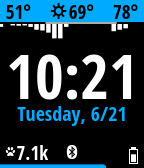

<!-- Generated by scripts/update_app_directory.py: do not edit by hand -->
[← All Pebble Developers](../developers.md)

# Stefan Heule

*2 watchfaces · Last updated 2026-10-11 · [About these lists](../about-app-lists.md)*

Links: [Rebble App Store](https://apps.rebble.io/en_US/developer/55ab3ca04f0cf8279e00003c/1) · [Pebble App Store](https://apps.repebble.com/apps/dev/stefan-heule_55ab3ca04f0cf8279e00003c) · [GitHub (stefanheule)](https://github.com/stefanheule) · [Website (stefanheule.com)](https://stefanheule.com/graphite/)

<button type="button" data-filter="all" aria-pressed="true">All 2</button><button type="button" data-filter="watchface" aria-pressed="false">Watchfaces 2</button><button type="button" data-filter="watchapp" aria-pressed="false" disabled>Apps 0</button>

<label class="dev-sort">Sort by <select><option value="updated">Recently updated</option><option value="released">Newest release</option><option value="title">A–Z</option></select></label>

<h2 class="app-name" id="app-58a64c9c6ca3877261000466"><a href="https://apps.rebble.io/en_US/application/58a64c9c6ca3877261000466">Graphite</a> v1.4</h2>
<a class="app-source" href="https://github.com/stefanheule/graphite" title="Source code" data-search-exclude>View source</a>

Watchface

Released 2017-02-17 Updated 2017-05-11 Rebble App Store

Runs on: Time 2, Time

Free and open source watchapp for the Pebble Time and Pebble Time Steel. It&#x27;s simple, elegant and highly configurable. Features include: - 24h rain preview: Shows an hourly chance of percipitation…

<h2 class="app-name" id="app-55ee57da2b0b31132c00008b"><a href="https://apps.repebble.com/55ee57da2b0b31132c00008b">Obsidian</a> v3.3</h2>
<a class="app-source" href="https://github.com/stefanheule/obsidian" title="Source code" data-search-exclude>View source</a>

Watchface

Released 2015-09-08 Updated 2017-02-17

Runs on: Round 2, Time 2, Pebble 2 Duo, Pebble 2, Time Round, Time, Classic

This is a usable and elegant analog watchface for the Pebble Time. It&#x27;s designed such that the watch hands never cover the date or weather information. It&#x27;s main features are: - High contrast…

