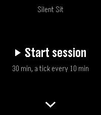

<!-- Generated by scripts/update_app_directory.py: do not edit by hand -->
[← All Pebble Developers](../developers.md)

# Stefano Verna

*1 app · Last updated 2026-10-11 · [About these lists](../about-app-lists.md)*

Links: [Pebble App Store](https://apps.repebble.com/apps/dev/stefano-verna_c5e307b33ca3e561263b6720) · [GitHub (stefanoverna)](https://github.com/stefanoverna)

<h2 class="app-name" id="app-9170d8ea82e842e6b0abdbe3"><a href="https://apps.repebble.com/9170d8ea82e842e6b0abdbe3">Silent Sit</a> v1.1.0</h2>
<a class="app-source" href="https://github.com/stefanoverna/silent-sit-pebble" title="Source code" data-search-exclude>View source</a>

App

Released 2026-06-23 Updated 2026-06-27

Runs on: Time 2

Silent Sit — Silent, tactile meditation timer Silent Sit paces your sitting with vibrations alone. No bells, no sound, no screen to look at: you feel the rhythm on your wrist and keep your eyes…

