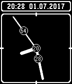

<!-- Generated by scripts/update_app_directory.py: do not edit by hand -->
[← All Pebble Developers](../developers.md)

# stepardo

*1 watchface · Last updated 2026-10-11 · [About these lists](../about-app-lists.md)*

Links: [Rebble App Store](https://apps.rebble.io/en_US/developer/58b742146ca387216b000254/1) · [GitHub (stepardo)](https://github.com/stepardo) · [Website (stepardo.de)](https://www.stepardo.de)

<h2 class="app-name" id="app-5957ec9b0dfc32b63e001892"><a href="https://apps.rebble.io/en_US/application/5957ec9b0dfc32b63e001892">Bubble Watch</a> v1.7</h2>
<a class="app-source" href="https://github.com/stepardo/bubblewatch" title="Source code" data-search-exclude>View source</a>

Watchface

Released 2017-07-01 Updated 2017-07-04 Rebble App Store

Runs on: Time 2, Pebble 2 Duo, Pebble 2, Time, Classic

This is a watchface that I created for my own enjoyment. I publish it here so that others can enjoy it as well. The point of this watchface is that it is a funny mixture of digital and analog…

