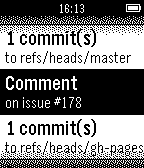

<!-- Generated by scripts/update_app_directory.py: do not edit by hand -->
[← All Pebble Developers](../developers.md)

# Stephen Mitchell

*1 app · Last updated 2026-10-11 · [About these lists](../about-app-lists.md)*

Links: [Pebble App Store](https://apps.repebble.com/apps/dev/stephen-mitchell_546e289f13159f3bbe0000c5) · [GitHub (stephen-mitchell)](https://github.com/stephen-mitchell)

<h2 class="app-name" id="app-54c007c60badda05e600006b"><a href="https://apps.repebble.com/54c007c60badda05e600006b">PebHub: Unofficial GitHub Client for Pebble</a> v0.2</h2>
<a class="app-source" href="https://github.com/stephen-mitchell/PebHub" title="Source code" data-search-exclude>View source</a>

App

Released 2015-01-21 Updated 2015-02-02

Runs on: Time 2, Pebble 2 Duo, Pebble 2, Time, Classic

View your most recent GitHub notifications on your Pebble

