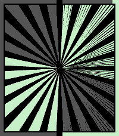
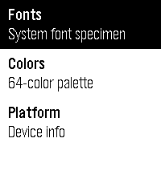

<!-- Generated by scripts/update_app_directory.py: do not edit by hand -->
[← All Pebble Developers](../developers.md)

# Sterling Ely

*1 watchface and 1 app · Last updated 2026-10-12 · [About these lists](../about-app-lists.md)*

Links: [Pebble App Store](https://apps.repebble.com/apps/dev/sterling-ely_52f01309f27a483dd1000171) · [GitHub (SterlingEly)](https://github.com/SterlingEly) · [Website (x.com)](http://x.com/sterlingely)

<button type="button" data-filter="all" aria-pressed="true">All 2</button><button type="button" data-filter="watchface" aria-pressed="false">Watchfaces 1</button><button type="button" data-filter="watchapp" aria-pressed="false">Apps 1</button>

<label class="dev-sort">Sort by <select><option value="updated">Recently updated</option><option value="released">Newest release</option><option value="title">A–Z</option></select></label>

<h2 class="app-name" id="app-69a6531826cc4f0009c65926"><a href="https://apps.repebble.com/69a6531826cc4f0009c65926">Radium 2 (Radial Bar Graph)</a> v2.3.1</h2>
<a class="app-source" href="https://github.com/SterlingEly/Radium2" title="Source code" data-search-exclude>View source</a>

Watchface · <a href="https://forum.rebble.io/t/734" title="Discuss this app on the Rebble forum" data-search-exclude>Forum thread</a>

No licence Released 2026-03-03 Updated 2026-05-24

Runs on: Round 2, Time 2, Pebble 2 Duo, Pebble 2, Time Round, Time, Classic

A radial bar graph watchface. Time and energy flowing around your wrist — hours and minutes as arcs, with battery &amp; steps or sunrise &amp; sunset on the outer ring. The left half of the face fills…

<h2 class="app-name" id="app-62bf6209f6d2473b895d2f03"><a href="https://apps.repebble.com/62bf6209f6d2473b895d2f03">Pixel Sampler</a> v1.0</h2>
<a class="app-source" href="https://github.com/SterlingEly/PixelSampler" title="Source code" data-search-exclude>View source</a>

App · <a href="https://forum.rebble.io/t/872" title="Discuss this app on the Rebble forum" data-search-exclude>Forum thread</a>

No licence Released 2026-04-13 Updated 2026-04-13

Runs on: Round 2, Time 2, Pebble 2 Duo, Pebble 2, Time Round, Time, Classic

The Pebble developer&#x27;s on-wrist reference. Building a Pebble app and need to check what LECO 38 Bold looks like, or grab the hex code for GColorVividCerulean? Stop switching windows. Pixel Sampler…

