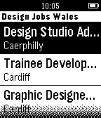

<!-- Generated by scripts/update_app_directory.py: do not edit by hand -->
[← All Pebble Developers](../developers.md)

# Steve Halford

*1 app · Last updated 2026-10-11 · [About these lists](../about-app-lists.md)*

Links: [Pebble App Store](https://apps.repebble.com/apps/dev/steve-halford_5369045f36b875f4640001a9) · [GitHub (stevehalford)](https://github.com/stevehalford) · [Website (designjobswales.co.uk)](http://www.designjobswales.co.uk)

<h2 class="app-name" id="app-55002392bab0598ad60000b9"><a href="https://apps.repebble.com/55002392bab0598ad60000b9">Design Jobs Wales</a> v1.0</h2>
<a class="app-source" href="https://github.com/stevehalford/DJWPebble" title="Source code" data-search-exclude>View source</a>

App

Released 2015-03-11 Updated 2015-03-11

Runs on: Time 2, Pebble 2 Duo, Pebble 2, Time, Classic

Displays the latest jobs from Design Jobs Wales

