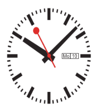
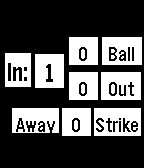
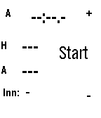

<!-- Generated by scripts/update_app_directory.py: do not edit by hand -->
[← All Pebble Developers](../developers.md)

# Steve Karmeinsky

*2 watchfaces and 2 apps · Last updated 2026-10-11 · [About these lists](../about-app-lists.md)*

Links: [Pebble App Store](https://apps.repebble.com/apps/dev/steve-karmeinsky_52e55acb6ff0da2ece000657) · [GitHub (stevekennedyuk)](https://github.com/stevekennedyuk) · [Website (nettek.co.uk)](https://nettek.co.uk)

<button type="button" data-filter="all" aria-pressed="true">All 4</button><button type="button" data-filter="watchface" aria-pressed="false">Watchfaces 2</button><button type="button" data-filter="watchapp" aria-pressed="false">Apps 2</button>

<label class="dev-sort">Sort by <select><option value="updated">Recently updated</option><option value="released">Newest release</option><option value="title">A–Z</option></select></label>

<h2 class="app-name" id="app-78798fba27ff4decac4355cb"><a href="https://apps.repebble.com/78798fba27ff4decac4355cb">Swiss Railway Watchface 2 (day next to date)</a> v1.1</h2>
<a class="app-source" href="https://github.com/stevekennedyuk/SwissRailwayWatch2" title="Source code" data-search-exclude>View source</a>

Watchface

Released 2026-03-13 Updated 2026-03-13

Runs on: Round 2, Time 2, Pebble 2 Duo, Pebble 2, Time Round, Time, Classic

A design based on the classic Swiss Railway Clock with day followed by date

<h2 class="app-name" id="app-fa268ce41bde414c87f52899"><a href="https://apps.repebble.com/fa268ce41bde414c87f52899">Swiss Railway Watch Face (Date over Day)</a> v1.2</h2>
<a class="app-source" href="https://github.com/stevekennedyuk/SwissRailwayWatch" title="Source code" data-search-exclude>View source</a>

Watchface

Released 2026-02-27 Updated 2026-03-02

Runs on: Round 2, Time 2, Pebble 2 Duo, Pebble 2, Time Round, Time, Classic

Based on the iconic Swiss Railway clock

<h2 class="app-name" id="app-550b1131ad7be0af4900003e"><a href="https://apps.repebble.com/550b1131ad7be0af4900003e">Softball/Baseball Umpire Clicker</a> v2.0</h2>
<a class="app-source" href="https://github.com/stevekennedyuk/SoftballUmpClicker" title="Source code" data-search-exclude>View source</a>

App

Released 2015-03-19 Updated 2016-03-02

Runs on: Round 2, Time 2, Pebble 2 Duo, Pebble 2, Time Round, Time, Classic

A simple ump clicker for softball UP increments balls SELECT increments outs DOWN increments strikes If BACK is (single) pressed it will take you back to the last state (i.e. if 4 balls so a walk…

<h2 class="app-name" id="app-5627b6cbcf5a8e00c600005f"><a href="https://apps.repebble.com/5627b6cbcf5a8e00c600005f">Indoor Softball Scorer</a> v1.3</h2>
<a class="app-source" href="https://github.com/stevekennedyuk/IndoorSoftballScoring" title="Source code" data-search-exclude>View source</a>

App

Released 2015-10-21 Updated 2016-03-01

Runs on: Round 2, Time 2, Pebble 2 Duo, Pebble 2, Time Round, Time, Classic

An app to help score indoor softball (and time innings), can be paused and restarted

