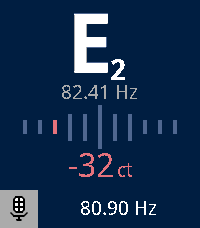

<!-- Generated by scripts/update_app_directory.py: do not edit by hand -->
[← All Pebble Developers](../developers.md)

# Steve Pastelan

*1 app · Last updated 2026-11-09 · [About these lists](../about-app-lists.md)*

Links: [Pebble App Store](https://apps.repebble.com/apps/dev/steve-pastelan_73430273fbf4d30193388d4a) · [GitHub (MajorMajorMajorMajor)](https://github.com/MajorMajorMajorMajor)

<h2 class="app-name" id="app-3b567006273941a788e44c03"><a href="https://apps.repebble.com/3b567006273941a788e44c03">Guitar Tuner</a> v1.0.1</h2>
<a class="app-source" href="https://github.com/MajorMajorMajorMajor/guitar-tuner" title="Source code" data-search-exclude>View source</a>

App

MIT Released 2026-11-05 Updated 2026-11-06

Runs on: Round 2, Time 2

Reimplementation of Adriel Cafe&#x27;s excellent Chroma tuner for Android (https://github.com/adrielcafe/chroma). Guitar Tuner is a chromatic tuner for Pebble Time 2 and Pebble Round 2. Pluck a string…

