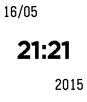
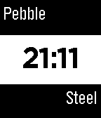

<!-- Generated by scripts/update_app_directory.py: do not edit by hand -->
[← All Pebble Developers](../developers.md)

# Stevegroves123

*2 watchfaces · Last updated 2026-10-12 · [About these lists](../about-app-lists.md)*

Links: [Pebble App Store](https://apps.repebble.com/apps/dev/stevegroves123_53785d26a434795600000045) · [GitHub (stevegroves123)](https://github.com/stevegroves123) · [Website (db.tt)](https://db.tt/RUUb1Z1v)

<button type="button" data-filter="all" aria-pressed="true">All 2</button><button type="button" data-filter="watchface" aria-pressed="false">Watchfaces 2</button><button type="button" data-filter="watchapp" aria-pressed="false" disabled>Apps 0</button>

<label class="dev-sort">Sort by <select><option value="updated">Recently updated</option><option value="released">Newest release</option><option value="title">A–Z</option></select></label>

<h2 class="app-name" id="app-5557b9c76c5443b286000025"><a href="https://apps.repebble.com/5557b9c76c5443b286000025">Colour_Time</a> v3.3</h2>
<a class="app-source" href="https://github.com/stevegroves123/Pebble_time_watchface.git" title="Source code" data-search-exclude>View source</a>

Watchface

Released 2015-05-16 Updated 2015-06-13

Runs on: Time 2, Time

This is a basic watch face, the user is able to change the top/bottom colour from a short list. Feel free to use / improve on the code.

<h2 class="app-name" id="app-554fca829d1dd78858000091"><a href="https://apps.repebble.com/554fca829d1dd78858000091">SG Steel</a> v1.42</h2>
<a class="app-source" href="https://github.com/stevegroves123/Steel_words" title="Source code" data-search-exclude>View source</a>

Watchface

Released 2015-05-10 Updated 2015-05-10

Runs on: Time 2, Pebble 2 Duo, Pebble 2, Time, Classic

Simple watch face created to show the time

