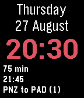

<!-- Generated by scripts/update_app_directory.py: do not edit by hand -->
[← All Pebble Developers](../developers.md)

# Steven Blair

*1 watchface · Last updated 2026-10-11 · [About these lists](../about-app-lists.md)*

Links: [Pebble App Store](https://apps.repebble.com/apps/dev/steven-blair_556ce3024155355d5b000056) · [GitHub (stevenblair)](https://github.com/stevenblair)

<h2 class="app-name" id="app-55de44a8c46b80387c000070"><a href="https://apps.repebble.com/55de44a8c46b80387c000070">Commuter Bliss UK</a> v1.91</h2>
<a class="app-source" href="https://github.com/stevenblair/commuter-bliss-uk" title="Source code" data-search-exclude>View source</a>

Watchface

Released 2015-08-26 Updated 2017-12-29

Runs on: Time 2, Pebble 2 Duo, Pebble 2, Time, Classic

A Pebble watchface for UK rail commuters. Displays the next three trains for your daily commute to and from work. The immediate next train is shown in detail in bold. It is designed to require…

