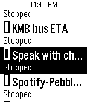
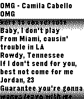

<!-- Generated by scripts/update_app_directory.py: do not edit by hand -->
[← All Pebble Developers](../developers.md)

# Steven Go

*2 apps · Last updated 2026-10-12 · [About these lists](../about-app-lists.md)*

Links: [Rebble App Store](https://apps.rebble.io/en_US/developer/58d3bcef6ca387cb86000cf8/1) · [GitHub (greenlover1991)](https://github.com/greenlover1991) · [Website (llamalab.com)](https://llamalab.com/automate/community/flows/16413)

<button type="button" data-filter="all" aria-pressed="true">All 2</button><button type="button" data-filter="watchface" aria-pressed="false" disabled>Watchfaces 0</button><button type="button" data-filter="watchapp" aria-pressed="false">Apps 2</button>

<label class="dev-sort">Sort by <select><option value="updated">Recently updated</option><option value="released">Newest release</option><option value="title">A–Z</option></select></label>

<h2 class="app-name" id="app-5afda2da461a8d6af4000d7b"><a href="https://apps.rebble.io/en_US/application/5afda2da461a8d6af4000d7b">Remote for Automate</a> v1.1</h2>
<a class="app-source" href="https://github.com/greenlover1991/pebble-remote-for-automate" title="Source code" data-search-exclude>View source</a>

App

No licence Released 2018-05-17 Updated 2018-05-17 Rebble App Store

Runs on: Round 2, Time 2, Pebble 2 Duo, Pebble 2, Time Round, Time, Classic

Ever wanted to have more control of your phone via your Pebble? Wanted to send a text, start the flashlight, toggle the WiFi, get the bus&#x27; ETA, send an HTTP request with parameters, trigger the…

<h2 class="app-name" id="app-59dceb380dfc32af61003d5a"><a href="https://apps.rebble.io/en_US/application/59dceb380dfc32af61003d5a">Simple Lyrics Viewer</a> v1.0</h2>
<a class="app-source" href="https://github.com/greenlover1991/pebble-lyrics-viewer" title="Source code" data-search-exclude>View source</a>

App

No licence Released 2017-10-10 Updated 2017-10-11 Rebble App Store

Runs on: Time 2, Pebble 2 Duo, Pebble 2, Time, Classic

Simple scollable Lyrics Viewer - ANDROID only - REQUIRES Automate Flow companion to properly work. Link at the external website link. - REQUIRES Spotify&#x27;s &quot;Device Broadcast Status&quot; is enabled …

