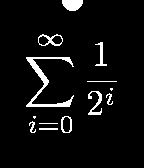

<!-- Generated by scripts/update_app_directory.py: do not edit by hand -->
[← All Pebble Developers](../developers.md)

# Steven Schmatz

*2 watchfaces · Last updated 2026-10-11 · [About these lists](../about-app-lists.md)*

Links: [Pebble App Store](https://apps.repebble.com/apps/dev/steven-schmatz_52fecd72c7c81b6aaa00001e) · [GitHub (stevenschmatz)](https://github.com/stevenschmatz) · [Website (stevenschmatz.com)](http://www.stevenschmatz.com/)

<button type="button" data-filter="all" aria-pressed="true">All 2</button><button type="button" data-filter="watchface" aria-pressed="false">Watchfaces 2</button><button type="button" data-filter="watchapp" aria-pressed="false" disabled>Apps 0</button>

<label class="dev-sort">Sort by <select><option value="updated">Recently updated</option><option value="released">Newest release</option><option value="title">A–Z</option></select></label>

<h2 class="app-name" id="app-55dd71ef4374cb4eb300000f"><a href="https://apps.repebble.com/55dd71ef4374cb4eb300000f">Segments</a> v1.0</h2>
<a class="app-source" href="https://github.com/stevenschmatz/segments" title="Source code" data-search-exclude>View source</a>

Watchface

Released 2015-08-26 Updated 2015-08-26

Runs on: Time 2, Pebble 2 Duo, Pebble 2, Time, Classic

Segments is a simple watchface that counts the day down in 6 minute blocks. There are 240 of these blocks in a day – an easily number to comprehend. Better than 86,400 seconds in a day, and more…

<h2 class="app-name" id="app-5309427924c4582908000046"><a href="https://apps.repebble.com/5309427924c4582908000046">Math Geek</a> v1.0.1</h2>
<a class="app-source" href="https://github.com/stevenschmatz/math-geek-pebble-watchface" title="Source code" data-search-exclude>View source</a>

Watchface

Released 2014-02-23 Updated 2014-02-24

Runs on: Time 2, Pebble 2 Duo, Pebble 2, Time, Classic

For those with a need to embrace their inner geek. Minimalistic watchface that shows the hour in a LaTeX rendered mathematical expression, with a semicircle positioned at the minute position…

