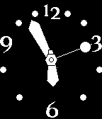
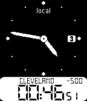

<!-- Generated by scripts/update_app_directory.py: do not edit by hand -->
[← All Pebble Developers](../developers.md)

# stibbons

*3 watchfaces · Last updated 2026-10-12 · [About these lists](../about-app-lists.md)*

Links: [Pebble App Store](https://apps.repebble.com/apps/dev/stibbons_529973e3e627cef4a800001f) · [GitHub (phardy)](https://github.com/phardy)

<button type="button" data-filter="all" aria-pressed="true">All 3</button><button type="button" data-filter="watchface" aria-pressed="false">Watchfaces 3</button><button type="button" data-filter="watchapp" aria-pressed="false" disabled>Apps 0</button>

<label class="dev-sort">Sort by <select><option value="updated">Recently updated</option><option value="released">Newest release</option><option value="title">A–Z</option></select></label>

<h2 class="app-name" id="app-529d7ab96794728567000017"><a href="https://apps.repebble.com/529d7ab96794728567000017">Gravity</a> v2.1.2</h2>
<a class="app-source" href="https://github.com/phardy/pebble-gravity" title="Source code" data-search-exclude>View source</a>

Watchface

Released 2013-12-03 Updated 2025-11-25

Runs on: Time 2, Pebble 2 Duo, Pebble 2, Time, Classic

This watchface has problems. The hands are far too heavy for the mechanism. They get pulled down by gravity, racing around the bottom of the watchface and only just barely making it over the top.

<h2 class="app-name" id="app-52997ea6e627ce3e78000023"><a href="https://apps.repebble.com/52997ea6e627ce3e78000023">DualTZ</a> v3.2</h2>
<a class="app-source" href="https://github.com/phardy/DualTZ" title="Source code" data-search-exclude>View source</a>

Watchface

Released 2013-11-30 Updated 2025-11-25

Runs on: Time 2, Pebble 2 Duo, Pebble 2, Time, Classic

A watchface that shows the local time on the analogue face, and the time in a configurable timezone below.

<h2 class="app-name" id="app-52cb88a4e2dd02bd640000f6"><a href="https://apps.repebble.com/52cb88a4e2dd02bd640000f6">Fireflies</a> v2.1.1</h2>
<a class="app-source" href="http://github.com/phardy/pebble-fireflies" title="Source code" data-search-exclude>View source</a>

Watchface

MIT Released 2014-01-07 Updated 2014-01-19

Runs on: Time 2, Pebble 2 Duo, Pebble 2, Time, Classic

Join me on a magical forest adventure where monochrome fireflies dance on your wrist. Normally, they swarm and blink and dance, but every minute or so, they join together and do their best to show…

