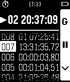
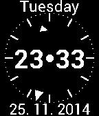

<!-- Generated by scripts/update_app_directory.py: do not edit by hand -->
[← All Pebble Developers](../developers.md)

# Stopka

*1 watchface and 1 app · Last updated 2026-10-11 · [About these lists](../about-app-lists.md)*

Links: [Pebble App Store](https://apps.repebble.com/apps/dev/stopka_52b3394dcd41836fcb000101) · [GitHub (Stopka)](https://github.com/Stopka)

<button type="button" data-filter="all" aria-pressed="true">All 2</button><button type="button" data-filter="watchface" aria-pressed="false">Watchfaces 1</button><button type="button" data-filter="watchapp" aria-pressed="false">Apps 1</button>

<label class="dev-sort">Sort by <select><option value="updated">Recently updated</option><option value="released">Newest release</option><option value="title">A–Z</option></select></label>

<h2 class="app-name" id="app-52cad8d66126ce217100005f"><a href="https://apps.repebble.com/52cad8d66126ce217100005f">StopWatch</a> v5.0</h2>
<a class="app-source" href="https://github.com/Stopka/StopWatch" title="Source code" data-search-exclude>View source</a>

App

No licence Released 2014-01-06 Updated 2015-03-15

Runs on: Time 2, Pebble 2 Duo, Pebble 2, Time, Classic

Supports - English, French, German and Spanish. A handy time measuring tool. You can create up to 10 independent timers and/or stopwatches. There are in fact no limits for maximum measured time…

<h2 class="app-name" id="app-52e019c0dbbbf9fbf4000143"><a href="https://apps.repebble.com/52e019c0dbbbf9fbf4000143">Digalog</a> v4.1</h2>
<a class="app-source" href="https://github.com/Stopka/Digalog" title="Source code" data-search-exclude>View source</a>

Watchface

No licence Released 2014-01-22 Updated 2014-12-10

Runs on: Time 2, Pebble 2 Duo, Pebble 2, Time, Classic

Simple and practical watchface showing week day, date and both digital and analog clock. On lost bluetooth connection it shows notification icon and vibes shortly. It shows also low pebble battery…

