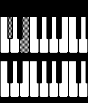
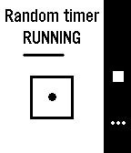
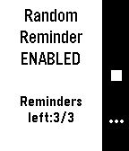
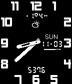

<!-- Generated by scripts/update_app_directory.py: do not edit by hand -->
[← All Pebble Developers](../developers.md)

# stosem

*3 watchfaces and 2 apps · Last updated 2026-10-11 · [About these lists](../about-app-lists.md)*

Links: [Rebble App Store](https://apps.rebble.io/en_US/developer/5a2a0e690dfc329d17001135/1) · [GitHub (stosem)](https://github.com/stosem)

<button type="button" data-filter="all" aria-pressed="true">All 5</button><button type="button" data-filter="watchface" aria-pressed="false">Watchfaces 3</button><button type="button" data-filter="watchapp" aria-pressed="false">Apps 2</button>

<label class="dev-sort">Sort by <select><option value="updated">Recently updated</option><option value="released">Newest release</option><option value="title">A–Z</option></select></label>

<h2 class="app-name" id="app-5ac4c075f38588510f00014b"><a href="https://apps.rebble.io/en_US/application/5ac4c075f38588510f00014b">Piano</a> v2.0</h2>
<a class="app-source" href="https://github.com/stosem/pebble-wf-Piano" title="Source code" data-search-exclude>View source</a>

Watchface

Released 2018-04-04 Updated 2018-04-11 Rebble App Store

Runs on: Round 2, Time 2, Pebble 2 Duo, Pebble 2, Time Round, Time, Classic

What is the sound of Time? Now you can see it. The first piano row is for showing hour. Bottom - minutes. Black keys - for the first digit of number (ten, twenty,...). White keys - second digit…

<h2 class="app-name" id="app-5abf41ee461a8d6af400030c"><a href="https://apps.rebble.io/en_US/application/5abf41ee461a8d6af400030c">Zen Time</a> v1.1</h2>
<a class="app-source" href="https://github.com/stosem/pebble-wf-ZenTime" title="Source code" data-search-exclude>View source</a>

Watchface

Released 2018-03-31 Updated 2018-04-05 Rebble App Store

Runs on: Round 2, Time 2, Pebble 2 Duo, Pebble 2, Time Round, Time, Classic

Zen time is eternal NOW. But you can also read approximate mental time by detecting position of zen-circle (hour) and dot around this circle (minute). In screenshots it is a 11:00, 6:45, 3:30. To…

<h2 class="app-name" id="app-5abf322df38588510f000046"><a href="https://apps.rebble.io/en_US/application/5abf322df38588510f000046">RandomTimer</a> v1.1</h2>
<a class="app-source" href="https://github.com/stosem/pebble-app-RandomTimer" title="Source code" data-search-exclude>View source</a>

App

Released 2018-03-31 Updated 2018-04-04 Rebble App Store

Runs on: Round 2, Time 2, Pebble 2 Duo, Pebble 2, Time Round, Time, Classic

RandomTimer. Countdown timer with random interval. Useful for board or party games (like hot potato) with reaction. Also may used in some other practice where you need a countdown that will expire…

<h2 class="app-name" id="app-5ac4bf6cf38588775f000125"><a href="https://apps.rebble.io/en_US/application/5ac4bf6cf38588775f000125">RandomReminder</a> v1.0</h2>
<a class="app-source" href="https://github.com/stosem/pebble-app-RandomReminder" title="Source code" data-search-exclude>View source</a>

App

Released 2018-04-04 Updated 2018-04-04 Rebble App Store

Runs on: Round 2, Time 2, Pebble 2 Duo, Pebble 2, Time Round, Time, Classic

RandomReminder. You can set up to 8 remindes in a day which will be happend in random time on specified period. It useful for remind for drink enough of water in a day, step away from computer…

<h2 class="app-name" id="app-5aa584f10dfc325c1c0001f3"><a href="https://apps.rebble.io/en_US/application/5aa584f10dfc325c1c0001f3">Advanced Analog</a> v2.1</h2>
<a class="app-source" href="https://github.com/stosem/pebble-wf-AdvancedAnalog" title="Source code" data-search-exclude>View source</a>

Watchface

Released 2018-03-11 Updated 2018-03-15 Rebble App Store

Runs on: Round 2, Time 2, Pebble 2 Duo, Pebble 2, Time Round, Time, Classic

Analog Watchface with weather and health data. Features: - Support rectangle and round display. - White or black theme. - Bluetooth, QuietTime, Charge icons. - Display steps. - Battery indicator…

