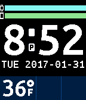

<!-- Generated by scripts/update_app_directory.py: do not edit by hand -->
[← All Pebble Developers](../developers.md)

# Stuart P. Bentley

*1 watchface · Last updated 2026-10-12 · [About these lists](../about-app-lists.md)*

Links: [Pebble App Store](https://apps.repebble.com/apps/dev/stuart-p-bentley_58508f51ce45dc5d1d000025) · [GitHub (stuartpb)](https://github.com/stuartpb)

<h2 class="app-name" id="app-58915f4895ce5bfaf80007d0"><a href="https://apps.repebble.com/58915f4895ce5bfaf80007d0">Rainpower</a> v1.0</h2>
<a class="app-source" href="https://github.com/stuartpb/rainpower-watchface" title="Source code" data-search-exclude>View source</a>

Watchface

Released 2017-02-01 Updated 2017-02-01

Runs on: Time 2, Time

This is a simple watchface that includes watch battery level, phone battery level (if your phone&#x27;s browser JavaScript run environment exposes it), a single-digit hour when in 12-hour mode (X, E…

