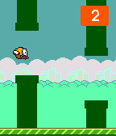
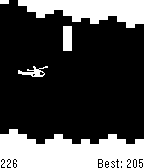

<!-- Generated by scripts/update_app_directory.py: do not edit by hand -->
[← All Pebble Developers](../developers.md)

# StuartHa

*2 apps · Last updated 2026-10-12 · [About these lists](../about-app-lists.md)*

Links: [Pebble App Store](https://apps.repebble.com/apps/dev/stuartha_52ab9742951e34594b000002) · [GitHub (StuartHa)](https://github.com/StuartHa)

<button type="button" data-filter="all" aria-pressed="true">All 2</button><button type="button" data-filter="watchface" aria-pressed="false" disabled>Watchfaces 0</button><button type="button" data-filter="watchapp" aria-pressed="false">Apps 2</button>

<label class="dev-sort">Sort by <select><option value="updated">Recently updated</option><option value="released">Newest release</option><option value="title">A–Z</option></select></label>

<h2 class="app-name" id="app-52f7a04b777f7eee6d000258"><a href="https://apps.repebble.com/52f7a04b777f7eee6d000258">Tiny Bird</a> v2.0</h2>
<a class="app-source" href="https://github.com/StuartHa/tiny_bird" title="Source code" data-search-exclude>View source</a>

App

No licence Released 2014-02-09 Updated 2015-12-13

Runs on: Round 2, Time 2, Pebble 2 Duo, Pebble 2, Time Round, Time, Classic

Port of Flappy Bird. By Stuart Harrell. Support developer by donating via Paypal to skh076000@gmail.com Colorized for Pebble Time by Frank Martinez (Dezign999).

<h2 class="app-name" id="app-52f4b8e3414fbc1ac100062e"><a href="https://apps.repebble.com/52f4b8e3414fbc1ac100062e">Helibble</a> v1.0.0</h2>
<a class="app-source" href="https://github.com/StuartHa/helibble" title="Source code" data-search-exclude>View source</a>

App

No licence Released 2014-02-07 Updated 2014-02-07

Runs on: Time 2, Pebble 2 Duo, Pebble 2, Time, Classic

Classic helicopter. By Stuart Harrell.

