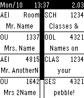

<!-- Generated by scripts/update_app_directory.py: do not edit by hand -->
[← All Pebble Developers](../developers.md)

# Stubenhocker

*1 watchface · Last updated 2026-10-12 · [About these lists](../about-app-lists.md)*

Links: [Pebble App Store](https://apps.repebble.com/apps/dev/stubenhocker_53832852b422c86073000076) · [GitHub (Stubenhocker1399)](https://github.com/Stubenhocker1399)

<h2 class="app-name" id="app-54f07932f44e0d1c1d00005b"><a href="https://apps.repebble.com/54f07932f44e0d1c1d00005b">School Schedule for Pebble</a> v1.1</h2>
<a class="app-source" href="https://github.com/Stubenhocker1399/school-schedule-for-pebble" title="Source code" data-search-exclude>View source</a>

Watchface

No licence Released 2015-02-27 Updated 2015-02-27

Runs on: Time 2, Pebble 2 Duo, Pebble 2, Time, Classic

This watchface shows your classes for today (left side) and tomorrow (right side), changing between even and uneven weeks. It currently has no settings, so you&#x27;re required to download the source…

