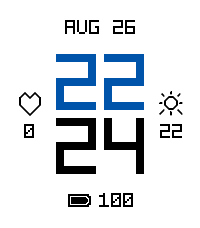

<!-- Generated by scripts/update_app_directory.py: do not edit by hand -->
[← All Pebble Developers](../developers.md)

# Suboptimal

*1 watchface · Last updated 2026-10-12 · [About these lists](../about-app-lists.md)*

Links: [Pebble App Store](https://apps.repebble.com/apps/dev/suboptimal_1d661ee76dcd927ce38ec010) · [GitHub (JimmyMultani)](https://github.com/JimmyMultani)

<h2 class="app-name" id="app-334f1266fd1c4c97bbd2e502"><a href="https://apps.repebble.com/334f1266fd1c4c97bbd2e502">Glitch</a> v1.1.2</h2>
<a class="app-source" href="https://github.com/JimmyMultani/pebble-watchfaces" title="Source code" data-search-exclude>View source</a>

Watchface

No licence Released 2026-08-18 Updated 2026-09-05

Runs on: Round 2, Time 2

A pixel-art watchface with dot-matrix digits and corner-bracket complications for weather, heart rate, steps, and battery.

