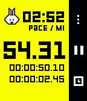

<!-- Generated by scripts/update_app_directory.py: do not edit by hand -->
[← All Pebble Developers](../developers.md)

# sunpazed

*1 app · Last updated 2026-10-12 · [About these lists](../about-app-lists.md)*

Links: [GitHub (sunpazed)](https://github.com/sunpazed)

<h2 class="app-name" id="app-5822f80d34da21ff12000122"><a href="https://apps.repebble.com/5822f80d34da21ff12000122">Stopwatch+</a></h2>
<a class="app-source" href="https://github.com/sunpazed/Pebble-Stopwatch-Plus" title="Source code" data-search-exclude>View source</a>

App

Updated unknown

An updated Stopwatch that tracks your running stats. Measure and track Distance and Pace - all without a companion app on your phone.

