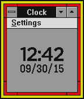

<!-- Generated by scripts/update_app_directory.py: do not edit by hand -->
[← All Pebble Developers](../developers.md)

# Superblock

*1 watchface · Last updated 2026-10-12 · [About these lists](../about-app-lists.md)*

Links: [Pebble App Store](https://apps.repebble.com/apps/dev/superblock_52f07759bb34233437001b7b) · [GitHub (jcs)](https://github.com/jcs)

<h2 class="app-name" id="app-560bfdaf4bf0ac562000007d"><a href="https://apps.repebble.com/560bfdaf4bf0ac562000007d">Hot Dog Stand</a> v1.5</h2>
<a class="app-source" href="https://github.com/jcs/pebble-hotdogstand" title="Source code" data-search-exclude>View source</a>

Watchface

No licence Released 2015-09-30 Updated 2016-09-08

Runs on: Time 2, Pebble 2 Duo, Pebble 2, Time, Classic

An ode to the Windows 3.1 Hot Dog Stand theme.

