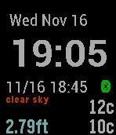

<!-- Generated by scripts/update_app_directory.py: do not edit by hand -->
[← All Pebble Developers](../developers.md)

# SurfnKen

*1 watchface · Last updated 2026-10-12 · [About these lists](../about-app-lists.md)*

Links: [Pebble App Store](https://apps.repebble.com/apps/dev/surfnken_52f16fc6e21be466e70001c1) · [GitHub (paddlebike)](https://github.com/paddlebike)

<h2 class="app-name" id="app-5827a80e8c7fff9edf000099"><a href="https://apps.repebble.com/5827a80e8c7fff9edf000099">Riverwatch</a> v0.5</h2>
<a class="app-source" href="https://github.com/paddlebike/RiverWatch" title="Source code" data-search-exclude>View source</a>

Watchface

Released 2016-11-12 Updated 2016-11-16

Runs on: Time 2, Pebble 2 Duo, Pebble 2, Time, Classic

Watchface for monitoring your favorite USGS stream gauge. - Color coded local air and stream (if available) temperatures in either celsius or fahrenheit. - Stream level in either height or flow…

