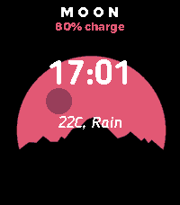

<!-- Generated by scripts/update_app_directory.py: do not edit by hand -->
[← All Pebble Developers](../developers.md)

# Sushant Rao

*1 watchface · Last updated 2026-10-11 · [About these lists](../about-app-lists.md)*

Links: [Rebble App Store](https://apps.rebble.io/en_US/developer/57e28c5c87d6bbe13f00004d/1) · [GitHub (sushant10)](https://github.com/sushant10)

<h2 class="app-name" id="app-594e34a6b67f9fae6300142f"><a href="https://apps.rebble.io/en_US/application/594e34a6b67f9fae6300142f">Sushi&#x27;s Moon</a> v2.0</h2>
<a class="app-source" href="https://github.com/sushant10/Moon_Watchface/" title="Source code" data-search-exclude>View source</a>

Watchface

Released 2017-06-24 Updated 2017-06-28 Rebble App Store

Runs on: Round 2, Time 2, Pebble 2 Duo, Pebble 2, Time Round, Time, Classic

Minimalistic Watchface called MOON. Now choose between both Fahrenheit/Celsius in the config!!!!!! Shows the local weather! Shows battery status! Français Minimalistic Watchface appelé MOON…

