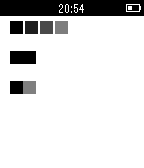

<!-- Generated by scripts/update_app_directory.py: do not edit by hand -->
[← All Pebble Developers](../developers.md)

# Svitlana Tsymbaliuk

*2 apps · Last updated 2026-10-11 · [About these lists](../about-app-lists.md)*

Links: [Pebble App Store](https://apps.repebble.com/apps/dev/svitlana-tsymbaliuk_53d24c81071db34b34000097) · [GitHub (svitlanatsymbaliuk)](https://github.com/svitlanatsymbaliuk)

<button type="button" data-filter="all" aria-pressed="true">All 2</button><button type="button" data-filter="watchface" aria-pressed="false" disabled>Watchfaces 0</button><button type="button" data-filter="watchapp" aria-pressed="false">Apps 2</button>

<label class="dev-sort">Sort by <select><option value="updated">Recently updated</option><option value="released">Newest release</option><option value="title">A–Z</option></select></label>

<h2 class="app-name" id="app-5469057015309c6c9600000e"><a href="https://apps.repebble.com/5469057015309c6c9600000e">Stack Attack</a> v1.0</h2>
<a class="app-source" href="https://github.com/svitlanatsymbaliuk/Stack-Attack-for-Pebble" title="Source code" data-search-exclude>View source</a>

App

Released 2014-11-16 Updated 2014-11-16

Runs on: Time 2, Pebble 2 Duo, Pebble 2, Time, Classic

Fill as many lines at the bottom as possible. Use UP and DOWN buttons to walk left/right and to push crates. To jump use SELECT. To use super jump press SELECT twice. Jump against a falling crate…

<h2 class="app-name" id="app-5468f5f4ecee199897000011"><a href="https://apps.repebble.com/5468f5f4ecee199897000011">Gradient test</a> v1.0</h2>
<a class="app-source" href="https://github.com/svitlanatsymbaliuk/Gradient" title="Source code" data-search-exclude>View source</a>

App

Released 2014-11-16 Updated 2014-11-16

Runs on: Time 2, Pebble 2 Duo, Pebble 2, Time, Classic

This test app shows how B/W screen can display gradient colors. There is no magic because Pebble screen can be updated up to 60 times in a second.

