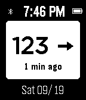
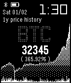
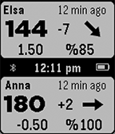
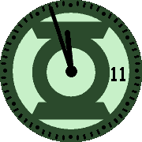

<!-- Generated by scripts/update_app_directory.py: do not edit by hand -->
[← All Pebble Developers](../developers.md)

# swansswansswansswanssosoft

*4 watchfaces · Last updated 2026-10-11 · [About these lists](../about-app-lists.md)*

Links: [Rebble App Store](https://apps.rebble.io/en_US/developer/5e65d05a3dd3108f341c08ea/1) · [GitHub (pauleeeeee)](https://github.com/pauleeeeee)

<button type="button" data-filter="all" aria-pressed="true">All 4</button><button type="button" data-filter="watchface" aria-pressed="false">Watchfaces 4</button><button type="button" data-filter="watchapp" aria-pressed="false" disabled>Apps 0</button>

<label class="dev-sort">Sort by <select><option value="updated">Recently updated</option><option value="released">Newest release</option><option value="title">A–Z</option></select></label>

<h2 class="app-name" id="app-5f682eb451c0ff2d3f0f28d8"><a href="https://apps.rebble.io/en_US/application/5f682eb451c0ff2d3f0f28d8">Dexcom Share CGM</a> v1.2</h2>
<a class="app-source" href="https://github.com/pauleeeeee/pebble-dexcom-share-cgm" title="Source code" data-search-exclude>View source</a>

Watchface

Released 2020-09-21 Updated 2021-12-10 Rebble App Store

Runs on: Round 2, Time 2, Pebble 2 Duo, Pebble 2, Time Round, Time, Classic

Updated Dexcom Share CGM watch face for the Pebble smart watch. Replaces Simple CGM which broke in September of 2020. This is a watch face that people with Type 1 Diabetes can use to monitor blood…

<h2 class="app-name" id="app-5ff3bb3c1e6bb18626ced4cb"><a href="https://apps.rebble.io/en_US/application/5ff3bb3c1e6bb18626ced4cb">Ticker</a> v1.0</h2>
<a class="app-source" href="https://github.com/pauleeeeee/pebble-stock-ticker" title="Source code" data-search-exclude>View source</a>

Watchface

Released 2021-01-05 Updated 2021-01-05 Rebble App Store

Runs on: Time 2, Pebble 2 Duo, Pebble 2, Time, Classic

Display the current and historical price of most cryptocurrencies as well as most publicly traded stocks on the major exchanges. Unfortunately, real-time data is not currently available for stocks…

<h2 class="app-name" id="app-5e7449b43dd3109103feea94"><a href="https://apps.rebble.io/en_US/application/5e7449b43dd3109103feea94">Nightscout Double Vision</a> v1.8</h2>
<a class="app-source" href="https://github.com/pauleeeeee/nightscout-double-vision" title="Source code" data-search-exclude>View source</a>

Watchface

Released 2020-03-20 Updated 2021-01-05 Rebble App Store

Runs on: Time 2, Pebble 2 Duo, Pebble 2, Time, Classic

Nightscout Double Vision allows you to track two people with Type-1 Diabetes (T1D) and display their Nightscout information on one Pebble watchface. Double Vision was originally modeled after the…

<h2 class="app-name" id="app-5e9be8613dd31033ee19420e"><a href="https://apps.rebble.io/en_US/application/5e9be8613dd31033ee19420e">The Green Lantern</a> v1.0</h2>
<a class="app-source" href="https://github.com/pauleeeeee/the-green-lantern-pebble-watchface" title="Source code" data-search-exclude>View source</a>

Watchface

Released 2020-04-19 Updated 2020-04-19 Rebble App Store

Runs on: Round 2, Time Round

The Green Lantern symbol on your wrist.

