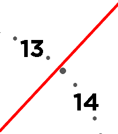

<!-- Generated by scripts/update_app_directory.py: do not edit by hand -->
[← All Pebble Developers](../developers.md)

# Swantzter

*1 watchface · Last updated 2026-10-11 · [About these lists](../about-app-lists.md)*

Links: [Pebble App Store](https://apps.repebble.com/apps/dev/swantzter_38e5d794bccd962d453ae6de) · [GitHub (swantzter)](https://github.com/swantzter)

<h2 class="app-name" id="app-c28d55850fee42f3a80d66cc"><a href="https://apps.repebble.com/c28d55850fee42f3a80d66cc">Macro Clock</a> v3.0.0</h2>
<a class="app-source" href="https://github.com/swantzter/PebbleMacroClock" title="Source code" data-search-exclude>View source</a>

Watchface · <a href="https://forum.rebble.io/t/1019" title="Discuss this app on the Rebble forum" data-search-exclude>Forum thread</a>

Released 2026-06-03 Updated 2026-06-03

Runs on: Time 2, Time

A version of shamHu&#x27;s Macro Clock that works on the new core devices app and the newer watches&#x27; larger screens. This clock features a zoomed in clock face where you only see the hour-hand…

