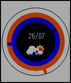

<!-- Generated by scripts/update_app_directory.py: do not edit by hand -->
[← All Pebble Developers](../developers.md)

# Swapnull

*1 watchface · Last updated 2026-10-11 · [About these lists](../about-app-lists.md)*

Links: [Pebble App Store](https://apps.repebble.com/apps/dev/swapnull_535e47543b591e694c00019e) · [GitHub (Swapnull)](https://github.com/Swapnull)

<h2 class="app-name" id="app-55b4b6b6138347ac64000049"><a href="https://apps.repebble.com/55b4b6b6138347ac64000049">Doughnut</a> v1.0</h2>
<a class="app-source" href="https://github.com/Swapnull/Doughnut" title="Source code" data-search-exclude>View source</a>

Watchface

MIT Released 2015-07-26 Updated 2015-07-26

Runs on: Time 2, Time

A simple watchface with three rings. Seconds is the outer (orange) ring, minutes is the middle (blue) ring and hours is the center (black) ring. The weather and date is also displayed in the…

