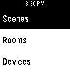

<!-- Generated by scripts/update_app_directory.py: do not edit by hand -->
[← All Pebble Developers](../developers.md)

# Swisskid

*1 app · Last updated 2026-10-12 · [About these lists](../about-app-lists.md)*

Links: [Pebble App Store](https://apps.repebble.com/apps/dev/swisskid_5396b6edae4b4c2f8800000d) · [GitHub (SwissKid)](https://github.com/SwissKid)

<h2 class="app-name" id="app-5591f1640c3212b7dc0000ad"><a href="https://apps.repebble.com/5591f1640c3212b7dc0000ad">Insteon Control</a> v1.01</h2>
<a class="app-source" href="https://github.com/SwissKid/pebble-insteon-control" title="Source code" data-search-exclude>View source</a>

App

No licence Released 2015-06-30 Updated 2015-06-30

Runs on: Time 2, Pebble 2 Duo, Pebble 2, Time, Classic

Insteon control Not functioning for everyone, and I haven&#x27;t been able to find the source of the issue. Only reason it&#x27;s up is because the users who it *was* functioning for requested I leave it…

