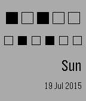
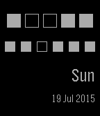

<!-- Generated by scripts/update_app_directory.py: do not edit by hand -->
[← All Pebble Developers](../developers.md)

# Switha

*2 watchfaces · Last updated 2026-10-11 · [About these lists](../about-app-lists.md)*

Links: [Pebble App Store](https://apps.repebble.com/apps/dev/switha_55abc3dd08692ba1b500007c) · [GitHub (switha)](https://github.com/switha)

<button type="button" data-filter="all" aria-pressed="true">All 2</button><button type="button" data-filter="watchface" aria-pressed="false">Watchfaces 2</button><button type="button" data-filter="watchapp" aria-pressed="false" disabled>Apps 0</button>

<label class="dev-sort">Sort by <select><option value="updated">Recently updated</option><option value="released">Newest release</option><option value="title">A–Z</option></select></label>

<h2 class="app-name" id="app-55abea254f0cf8b703000083"><a href="https://apps.repebble.com/55abea254f0cf8b703000083">Byte Watch White</a> v1.0</h2>
<a class="app-source" href="https://github.com/switha/ByteWatch/" title="Source code" data-search-exclude>View source</a>

Watchface

Released 2015-07-19 Updated 2015-07-19

Runs on: Time 2, Pebble 2 Duo, Pebble 2, Time, Classic

A simple 24hour binary clock. Hours in the top row, minutes in the middle. The MSB is on the left, for hours 16 and minutes 32. Also shows the day and date. White version

<h2 class="app-name" id="app-55abe31a08692b3a94000082"><a href="https://apps.repebble.com/55abe31a08692b3a94000082">Byte Watch Black</a> v1.0</h2>
<a class="app-source" href="https://github.com/switha/ByteWatch/" title="Source code" data-search-exclude>View source</a>

Watchface

Released 2015-07-19 Updated 2015-07-19

Runs on: Time 2, Pebble 2 Duo, Pebble 2, Time, Classic

A simple 24hour binary clock. Hours in the top row, minutes in the middle. The MSB is on the left, for hours 16 and minutes 32. Also shows the day and date.

