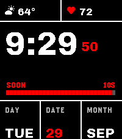

<!-- Generated by scripts/update_app_directory.py: do not edit by hand -->
[← All Pebble Developers](../developers.md)

# sybenx

*3 watchfaces · Last updated 2026-10-11 · [About these lists](../about-app-lists.md)*

Links: [Pebble App Store](https://apps.repebble.com/apps/dev/sybenx_d4c43f7b0132a46ff8340e8e) · [GitHub (sybenx)](https://github.com/sybenx)

<button type="button" data-filter="all" aria-pressed="true">All 3</button><button type="button" data-filter="watchface" aria-pressed="false">Watchfaces 3</button><button type="button" data-filter="watchapp" aria-pressed="false" disabled>Apps 0</button>

<label class="dev-sort">Sort by <select><option value="updated">Recently updated</option><option value="released">Newest release</option><option value="title">A–Z</option></select></label>

<h2 class="app-name" id="app-28a589e21b934ab6beac7b12"><a href="https://apps.repebble.com/28a589e21b934ab6beac7b12">Headway</a> v1.32.1</h2>
<a class="app-source" href="https://github.com/sybenx/headway" title="Source code" data-search-exclude>View source</a>

Watchface

Released 2026-09-23 Updated 2026-10-07

Runs on: Time 2, Pebble 2 Duo, Pebble 2, Time, Classic

A sleeve-aware transit watch: the time, heart rate, weather and date hang from the outer edge, the part a cuff uncovers first. Rain due within the hour shows on the face. Near Connect (Logan…

<h2 class="app-name" id="app-1269ce5888024c51a96e8b67"><a href="https://apps.repebble.com/1269ce5888024c51a96e8b67">Approach</a> v1.3.2</h2>
<a class="app-source" href="https://github.com/sybenx/approach" title="Source code" data-search-exclude>View source</a>

Watchface

Released 2026-09-22 Updated 2026-10-01

Runs on: Time 2, Pebble 2 Duo, Pebble 2, Time, Classic

Approach is a bold, high-contrast watchface built around the next mark. A segmented bar fills a minute at a time toward :00 and :30 (or every 15, 20 or 60 minutes, at any minutes past the hour)…

<h2 class="app-name" id="app-2e877455cf1342c8bbc73a51"><a href="https://apps.repebble.com/2e877455cf1342c8bbc73a51">TimeStyle Seconds</a> v7.12.1</h2>
<a class="app-source" href="https://github.com/sybenx/TimeStylePebble" title="Source code" data-search-exclude>View source</a>

Watchface

Released 2026-09-22 Updated 2026-09-22

Runs on: Round 2, Time 2, Pebble 2 Duo, Pebble 2, Time Round, Time

A fork of the TimeStyle watchface that shows seconds during the last minute of every 30-minute block (:29 and :59), stacking hours, minutes and seconds as three rows. Otherwise identical to…

