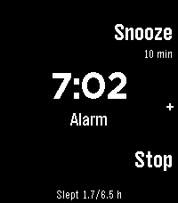
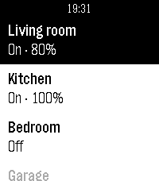
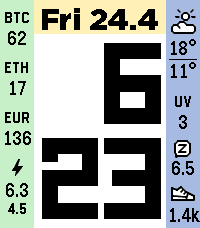
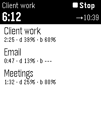

<!-- Generated by scripts/update_app_directory.py: do not edit by hand -->
[← All Pebble Developers](../developers.md)

# Sykerö Software

*1 watchface and 5 apps · Last updated 2026-10-11 · [About these lists](../about-app-lists.md)*

Links: [Pebble App Store](https://apps.repebble.com/apps/dev/syker-software_9f6c9c6e9ce88af6a0db953e) · [GitHub (Sykero-Software)](https://github.com/Sykero-Software) · [Website (sykero.fi)](https://sykero.fi)

<button type="button" data-filter="all" aria-pressed="true">All 6</button><button type="button" data-filter="watchface" aria-pressed="false">Watchfaces 1</button><button type="button" data-filter="watchapp" aria-pressed="false">Apps 5</button>

<label class="dev-sort">Sort by <select><option value="updated">Recently updated</option><option value="released">Newest release</option><option value="title">A–Z</option></select></label>

<h2 class="app-name" id="app-a993645f974e4673a215a9e0"><a href="https://apps.repebble.com/a993645f974e4673a215a9e0">Sykerö Smart Alarm</a> v1.4.1</h2>
<a class="app-source" href="https://github.com/Sykero-Software/PebbleSykeroAlarm" title="Source code" data-search-exclude>View source</a>

App

GPL-3.0 Released 2026-08-07 Updated 2026-09-04

Runs on: Time 2, Pebble 2 Duo, Pebble 2, Time

Sykerö Smart Alarm wakes you a few minutes early, at a moment you are already stirring — and never a minute later than the time you set. Instead of firing at the first twitch of movement, it…

<h2 class="app-name" id="app-dfc4441530f946c895d73257"><a href="https://apps.repebble.com/dfc4441530f946c895d73257">Tuya Lights</a> v1.1.3</h2>
<a class="app-source" href="https://github.com/Sykero-Software/PebbleTuyaControl" title="Source code" data-search-exclude>View source</a>

App

No licence Released 2026-06-16 Updated 2026-09-01

Runs on: Time 2, Pebble 2 Duo, Pebble 2, Time

Tuya Lights — control your smart lights from your wrist. See all your Tuya / Smart Life lights in one list and switch them on or off with a tap. Open a light to adjust its brightness and colour…

<h2 class="app-name" id="app-c1e3e132dae74bbcaf1a8320"><a href="https://apps.repebble.com/c1e3e132dae74bbcaf1a8320">Countdown timer</a> v1.1.13</h2>
<a class="app-source" href="https://github.com/Sykero-Software/PebbleCountdownTimer" title="Source code" data-search-exclude>View source</a>

App

GPL-3.0 Released 2026-06-16 Updated 2026-09-01

Runs on: Time 2, Pebble 2 Duo, Pebble 2, Time, Classic

Countdown timer — a simple multi-timer for your Pebble. Configure any number of named countdown timers (up to 16) from your phone, each with its own duration. On the watch you see the list and can…

<h2 class="app-name" id="app-66eceeb78146451aac714547"><a href="https://apps.repebble.com/66eceeb78146451aac714547">Sykerö TimeStyle</a> v8.10.0</h2>
<a class="app-source" href="https://github.com/Sykero-Software/TimeStylePebble" title="Source code" data-search-exclude>View source</a>

Watchface

GPL-3.0 Released 2026-06-25 Updated 2026-08-12

Runs on: Time 2, Pebble 2 Duo, Pebble 2, Time

Sykerö TimeStyle is a clean, highly configurable watchface — time, date, weather and two columns of optional widgets (battery, steps, sleep, electricity price, crypto, UV and more) with fully…

<h2 class="app-name" id="app-2c694894e79e439cb8db3033"><a href="https://apps.repebble.com/2c694894e79e439cb8db3033">Sykerö Track Work Time</a> v1.1.0</h2>
<a class="app-source" href="https://github.com/Sykero-Software/PebbleTrackWorkTime" title="Source code" data-search-exclude>View source</a>

App

GPL-3.0 Released 2026-06-25 Updated 2026-07-30

Runs on: Time 2, Pebble 2 Duo, Pebble 2, Time, Classic

Control Sykerö Track Work Time from your wrist. Start and stop work-time tracking, switch tasks, and see your current status — time worked today and time remaining — without reaching for your…

<h2 class="app-name" id="app-4e0ab343fe694b889ef1808d"><a href="https://apps.repebble.com/4e0ab343fe694b889ef1808d">MIDI Recorder</a> v1.0.4</h2>
<a class="app-source" href="https://github.com/Sykero-Software/PebbleMidiRecorder" title="Source code" data-search-exclude>View source</a>

App

GPL-3.0 Released 2026-06-25 Updated 2026-07-03

Runs on: Time 2, Pebble 2 Duo, Pebble 2, Time, Classic

Control MIDI Recorder from your wrist. Start and stop recording with one tap, and see the current recording time and the connected MIDI device at a glance — no need to pick up your phone…

