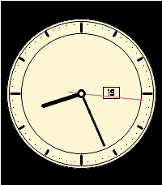
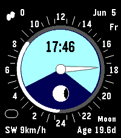

<!-- Generated by scripts/update_app_directory.py: do not edit by hand -->
[← All Pebble Developers](../developers.md)

# Synalysis

*3 watchfaces · Last updated 2026-10-12 · [About these lists](../about-app-lists.md)*

Links: [Pebble App Store](https://apps.repebble.com/apps/dev/synalysis_cc7bd1a5efe5d342dddfb4a7) · [GitHub (synalysis)](https://github.com/synalysis) · [Website (elm-pebble.dev)](https://elm-pebble.dev)

<button type="button" data-filter="all" aria-pressed="true">All 3</button><button type="button" data-filter="watchface" aria-pressed="false">Watchfaces 3</button><button type="button" data-filter="watchapp" aria-pressed="false" disabled>Apps 0</button>

<label class="dev-sort">Sort by <select><option value="updated">Recently updated</option><option value="released">Newest release</option><option value="title">A–Z</option></select></label>

<h2 class="app-name" id="app-affc96ec1b9a4016a9ec54f6"><a href="https://apps.repebble.com/affc96ec1b9a4016a9ec54f6">Classic Motivate</a> v1.0.2</h2>
<a class="app-source" href="https://github.com/synalysis/classic-motivate" title="Source code" data-search-exclude>View source</a>

Watchface

Released 2026-08-20 Updated 2026-08-20

Runs on: Round 2, Time 2, Pebble 2 Duo, Pebble 2, Time Round, Time

Analog watchface with a companion-configurable motivational quote that alternates with the clock.

<h2 class="app-name" id="app-872cc49a3c5c4e359d9f9e2c"><a href="https://apps.repebble.com/872cc49a3c5c4e359d9f9e2c">Yes Watch</a> v1.3.1</h2>
<a class="app-source" href="https://github.com/synalysis/yes-watch" title="Source code" data-search-exclude>View source</a>

Watchface · <a href="https://forum.rebble.io/t/451" title="Discuss this app on the Rebble forum" data-search-exclude>Forum thread</a>

Released 2026-01-04 Updated 2026-06-27

Runs on: Round 2, Time 2, Pebble 2 Duo, Pebble 2, Time Round, Time

The watchface resembles the Yes Watch and has features like sun rise / sun set, moon rise / moon set, moon phase, 24 h hand, and, of course, the time. The computations are done on the phone in…

<h2 class="app-name" id="app-e5117a814489481197412acf"><a href="https://apps.repebble.com/e5117a814489481197412acf">Tangram</a> v1.0.6</h2>
<a class="app-source" href="https://github.com/synalysis/elm-pebble" title="Source code" data-search-exclude>View source</a>

Watchface

Released 2026-05-19 Updated 2026-05-19

Runs on: Round 2, Time 2, Pebble 2 Duo, Pebble 2, Time Round, Time

Watchface showing changing Tangram shapes loaded online

