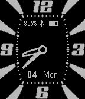
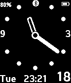

<!-- Generated by scripts/update_app_directory.py: do not edit by hand -->
[← All Pebble Developers](../developers.md)

# Szabolcs &quot;Sam&quot; Ban

*2 watchfaces · Last updated 2026-10-11 · [About these lists](../about-app-lists.md)*

Links: [Pebble App Store](https://apps.repebble.com/apps/dev/szabolcs-sam-ban_55ae2126f825d3aaf4000038) · [GitHub (ShoobyBan)](https://github.com/ShoobyBan) · [Website (wizguild.com)](http://wizguild.com/pebble-smartwatch/)

<button type="button" data-filter="all" aria-pressed="true">All 2</button><button type="button" data-filter="watchface" aria-pressed="false">Watchfaces 2</button><button type="button" data-filter="watchapp" aria-pressed="false" disabled>Apps 0</button>

<label class="dev-sort">Sort by <select><option value="updated">Recently updated</option><option value="released">Newest release</option><option value="title">A–Z</option></select></label>

<h2 class="app-name" id="app-5664345171fa343175000041"><a href="https://apps.repebble.com/5664345171fa343175000041">ShoMaurice</a> v4.3</h2>
<a class="app-source" href="https://github.com/ShoobyBan/PebbleShoMaurice" title="Source code" data-search-exclude>View source</a>

Watchface

GPL-2.0 Released 2015-12-06 Updated 2025-11-25

Runs on: Time 2, Pebble 2 Duo, Pebble 2, Time, Classic

Analog watch. Customizable colours, digital display, health (steps) integration, second handle, distinguishable minute and hour handles, day of the week, day of the month, bluetooth connection…

<h2 class="app-name" id="app-55d35a2bb8f18df809000022"><a href="https://apps.repebble.com/55d35a2bb8f18df809000022">ShoOne</a> v3.1</h2>
<a class="app-source" href="https://github.com/ShoobyBan/PebbleShoOne" title="Source code" data-search-exclude>View source</a>

Watchface

No licence Released 2015-08-18 Updated 2015-08-30

Runs on: Time 2, Pebble 2 Duo, Pebble 2, Time, Classic

This watchface is tailored to my taste. Analog watch with no second handle, rounded and distinguishable minute and hour handles, day of the week, day of the month, bluetooth connection vibration…

