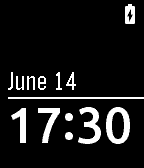

<!-- Generated by scripts/update_app_directory.py: do not edit by hand -->
[← All Pebble Developers](../developers.md)

# szendo

*3 watchfaces · Last updated 2026-10-11 · [About these lists](../about-app-lists.md)*

Links: [Pebble App Store](https://apps.repebble.com/apps/dev/szendo_5308904d8d051a758b000300) · [GitHub (szendo)](https://github.com/szendo)

<button type="button" data-filter="all" aria-pressed="true">All 3</button><button type="button" data-filter="watchface" aria-pressed="false">Watchfaces 3</button><button type="button" data-filter="watchapp" aria-pressed="false" disabled>Apps 0</button>

<label class="dev-sort">Sort by <select><option value="updated">Recently updated</option><option value="released">Newest release</option><option value="title">A–Z</option></select></label>

<h2 class="app-name" id="app-558435680a225df7640000b0"><a href="https://apps.repebble.com/558435680a225df7640000b0">Sliding Text&#x27;</a> v1.6.1</h2>
<a class="app-source" href="https://github.com/szendo/pebble--sliding-text" title="Source code" data-search-exclude>View source</a>

Watchface · <a href="https://forum.rebble.io/t/1272" title="Discuss this app on the Rebble forum" data-search-exclude>Forum thread</a>

Released 2015-06-19 Updated 2026-08-22

Runs on: Round 2, Time 2, Time Round, Time

Based on the classic Sliding Text watchface. It uses antialiased Roboto Bold/Light fonts to display the time.

<h2 class="app-name" id="app-557d63dba404afe20200000a"><a href="https://apps.repebble.com/557d63dba404afe20200000a">Simplicity&#x27;</a> v1.7.0</h2>
<a class="app-source" href="https://github.com/szendo/pebble--simplicity" title="Source code" data-search-exclude>View source</a>

Watchface · <a href="https://forum.rebble.io/t/1270" title="Discuss this app on the Rebble forum" data-search-exclude>Forum thread</a>

Released 2015-06-14 Updated 2026-08-22

Runs on: Round 2, Time 2, Time Round, Time

Based on the Simplicity watchface. Changes: - time uses Ubuntu font (antialiased) - date uses Gothic font - added battery status and Bluetooth connection indicators - day of the week above the…

<h2 class="app-name" id="app-55855cb56b94559b530000c5"><a href="https://apps.repebble.com/55855cb56b94559b530000c5">Fuzzy Time&#x27;</a> v1.6.1</h2>
<a class="app-source" href="https://github.com/szendo/pebble--fuzzy-time" title="Source code" data-search-exclude>View source</a>

Watchface · <a href="https://forum.rebble.io/t/1271" title="Discuss this app on the Rebble forum" data-search-exclude>Forum thread</a>

Released 2015-06-20 Updated 2026-08-22

Runs on: Round 2, Time 2, Time Round, Time

Based on the classic Sliding Text watchface. It uses antialiased Roboto Bold/Light fonts to display the time using fuzzy text.

