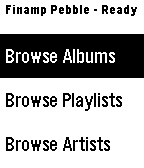

<!-- Generated by scripts/update_app_directory.py: do not edit by hand -->
[← All Pebble Developers](../developers.md)

# Tanner Meade

*1 app · Last updated 2026-10-11 · [About these lists](../about-app-lists.md)*

Links: [Pebble App Store](https://apps.repebble.com/apps/dev/tanner-meade_a804052e4bc7b7c1f5a3f7df) · [GitHub (tannermeade)](https://github.com/tannermeade)

<h2 class="app-name" id="app-a9e4acfbf46844e6b1a880df"><a href="https://apps.repebble.com/a9e4acfbf46844e6b1a880df">Finamp Remote (Jellyfin)</a> v1.0.0</h2>
<a class="app-source" href="https://github.com/tannermeade/finamp-remote-pebble" title="Source code" data-search-exclude>View source</a>

App

Released 2026-04-13 Updated 2026-04-13

Runs on: Round 2, Time 2, Pebble 2 Duo, Pebble 2, Time Round, Time, Classic

Pebble companion for Finamp, the Jellyfin music player. This requires some changes that I&#x27;ve made to finamp as well. I&#x27;ll be making a pull request to try to get them accepted into the official…

