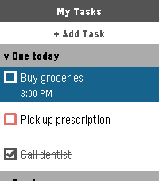

<!-- Generated by scripts/update_app_directory.py: do not edit by hand -->
[← All Pebble Developers](../developers.md)

# Tasks.org, LLC

*1 app · Last updated 2026-10-12 · [About these lists](../about-app-lists.md)*

Links: [Pebble App Store](https://apps.repebble.com/apps/dev/tasks-org-llc_e695d583988d356bd2ec81e0) · [GitHub (tasks)](https://github.com/tasks) · [Website (tasks.org)](https://tasks.org)

<h2 class="app-name" id="app-13e39c547aee442eb19a4755"><a href="https://apps.repebble.com/13e39c547aee442eb19a4755">Tasks.org</a> v15.6</h2>
<a class="app-source" href="https://github.com/tasks/tasks" title="Source code" data-search-exclude>View source</a>

App · <a href="https://forum.rebble.io/t/803" title="Discuss this app on the Rebble forum" data-search-exclude>Forum thread</a>

Released 2026-03-26 Updated 2026-03-28

Runs on: Round 2, Time 2, Pebble 2 Duo, Pebble 2, Time Round, Time, Classic

The official companion app for Tasks.org. Manage your CalDAV, Google Tasks, and Microsoft To Do lists directly from your wrist.

