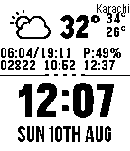

<!-- Generated by scripts/update_app_directory.py: do not edit by hand -->
[← All Pebble Developers](../developers.md)

# Tasnim Ahmed

*1 watchface · Last updated 2026-10-12 · [About these lists](../about-app-lists.md)*

Links: [Pebble App Store](https://apps.repebble.com/apps/dev/tasnim-ahmed_539280adca2234142b000091) · [GitHub (tazzix)](https://github.com/tazzix)

<h2 class="app-name" id="app-53e71ec8d889b3947f000051"><a href="https://apps.repebble.com/53e71ec8d889b3947f000051">All in One</a> v1.4</h2>
<a class="app-source" href="https://github.com/tazzix/AllinOnePebbleFace" title="Source code" data-search-exclude>View source</a>

Watchface

Released 2014-08-10 Updated 2015-12-15

Runs on: Time 2, Pebble 2 Duo, Pebble 2, Time, Classic

This Watchface is a fork of Chunk Weather 2.1, I have added more details for weather like Humidity, Sunrise, Sunset; as well as other features from other watchfaces / apps. It adds a pedometer…

