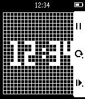

<!-- Generated by scripts/update_app_directory.py: do not edit by hand -->
[← All Pebble Developers](../developers.md)

# taturou

*2 watchfaces and 1 app · Last updated 2026-10-12 · [About these lists](../about-app-lists.md)*

Links: [Pebble App Store](https://apps.repebble.com/apps/dev/taturou_547d9dd836aa9b5fa40000ed) · [GitHub (taturou)](https://github.com/taturou)

<button type="button" data-filter="all" aria-pressed="true">All 3</button><button type="button" data-filter="watchface" aria-pressed="false">Watchfaces 2</button><button type="button" data-filter="watchapp" aria-pressed="false">Apps 1</button>

<label class="dev-sort">Sort by <select><option value="updated">Recently updated</option><option value="released">Newest release</option><option value="title">A–Z</option></select></label>

<h2 class="app-name" id="app-5567f5e4dd469916f300009d"><a href="https://apps.repebble.com/5567f5e4dd469916f300009d">XEVI NUMBER</a> v1.0</h2>
<a class="app-source" href="https://github.com/taturou/pebble_Xevious" title="Source code" data-search-exclude>View source</a>

Watchface

Released 2015-05-29 Updated 2015-05-29

Runs on: Time 2, Time

The Xevious number clock.

<h2 class="app-name" id="app-555d12564c2222794100004b"><a href="https://apps.repebble.com/555d12564c2222794100004b">Signal</a> v1.0</h2>
<a class="app-source" href="https://github.com/taturou/pebble_Signal" title="Source code" data-search-exclude>View source</a>

Watchface

Released 2015-05-20 Updated 2015-05-23

Runs on: Time 2, Time

This is a clock like a Japanese pedestrian signal. You can recognize the &quot;mm&quot; of &quot;YYYY-MM-DD hh:mm:ss&quot;. When the color is red, it is even number minutes now. When the color is green, it is odd…

<h2 class="app-name" id="app-54af21b5f663710a2d000102"><a href="https://apps.repebble.com/54af21b5f663710a2d000102">LifeGame</a> v1.0</h2>
<a class="app-source" href="https://github.com/taturou/pebble_LifeGameWatch" title="Source code" data-search-exclude>View source</a>

App

Released 2015-01-09 Updated 2015-05-22

Runs on: Time 2, Pebble 2 Duo, Pebble 2, Time, Classic

THE UNIVERSE IS ON YOUR WRIST. This app has four selectable modes. 1. Clock 2. Glider 3. Spaceship 4. R-pentomino

