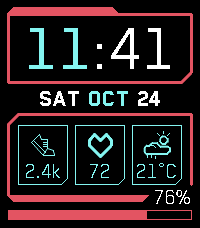

<!-- Generated by scripts/update_app_directory.py: do not edit by hand -->
[← All Pebble Developers](../developers.md)

# Taylor Silva

*1 watchface · Last updated 2026-11-02 · [About these lists](../about-app-lists.md)*

Links: [Pebble App Store](https://apps.repebble.com/apps/dev/taylor-silva_3f35d786fa620aa85206819a) · [GitHub (taylorsilva)](https://github.com/taylorsilva)

<h2 class="app-name" id="app-7115f04a3ab24c6e8b6ae927"><a href="https://apps.repebble.com/7115f04a3ab24c6e8b6ae927">Cyberpunk</a> v1.1.0</h2>
<a class="app-source" href="https://github.com/taylorsilva/cyberpunk-watchface" title="Source code" data-search-exclude>View source</a>

Watchface

Unlicense Released 2026-10-24 Updated 2026-10-24

Runs on: Time 2

A Pebble Time 2 watchface inspired by the Cyberpunk 2077 video game. There are three cards that can be displayed. Current display options are: - Steps - Heart rate - Current temperature and…

