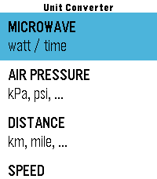
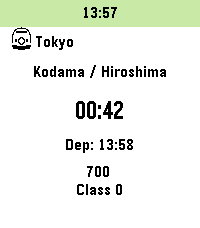
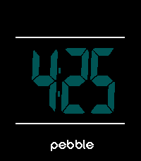
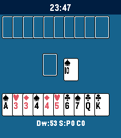

<!-- Generated by scripts/update_app_directory.py: do not edit by hand -->
[← All Pebble Developers](../developers.md)

# tc5206

*2 watchfaces and 3 apps · Last updated 2026-10-11 · [About these lists](../about-app-lists.md)*

Links: [Pebble App Store](https://apps.repebble.com/apps/dev/tc5206_f10b6e35701081a6841ded3d) · [GitHub (tc5206)](https://github.com/tc5206)

<button type="button" data-filter="all" aria-pressed="true">All 5</button><button type="button" data-filter="watchface" aria-pressed="false">Watchfaces 2</button><button type="button" data-filter="watchapp" aria-pressed="false">Apps 3</button>

<label class="dev-sort">Sort by <select><option value="updated">Recently updated</option><option value="released">Newest release</option><option value="title">A–Z</option></select></label>

<h2 class="app-name" id="app-51bcf10c57fa407181b80a1f"><a href="https://apps.repebble.com/51bcf10c57fa407181b80a1f">UNIT CONV JP</a> v1.1.0</h2>
<a class="app-source" href="https://github.com/tc5206/pebble_UNIT_CONV_JP" title="Source code" data-search-exclude>View source</a>

App

Released 2026-08-07 Updated 2026-08-23

Runs on: Round 2, Time 2, Pebble 2 Duo, Pebble 2, Time Round, Time, Classic

Description: A quick unit conversion app for when pulling out your smartphone feels like too much hassle. Inspired by small personal frustrations—such as &quot;I want to heat up my frozen food faster&quot;…

<h2 class="app-name" id="app-bd1149292c64436c938840dc"><a href="https://apps.repebble.com/bd1149292c64436c938840dc">Train 2 Time</a> v2.20.0</h2>
<a class="app-source" href="https://github.com/tc5206/pebble_Train2Time" title="Source code" data-search-exclude>View source</a>

App

Released 2026-03-18 Updated 2026-08-19

Runs on: Round 2, Time 2, Pebble 2 Duo, Pebble 2, Time Round, Time, Classic

Inspired by &quot;TrainTime&quot; by otoone_dev: https://apps.rebble.io/en_US/application/5904a0c90dfc329df8000706 I created this app to improve its usability for my own needs. It is a simple app that…

<h2 class="app-name" id="app-98336cbe9af04444be2f8673"><a href="https://apps.repebble.com/98336cbe9af04444be2f8673">wellew</a> v2.0</h2>
<a class="app-source" href="https://github.com/tc5206/pebble_wellew" title="Source code" data-search-exclude>View source</a>

Watchface

Released 2026-06-04 Updated 2026-06-06

Runs on: Round 2, Time 2, Pebble 2 Duo, Pebble 2, Time Round, Time, Classic

### Description A minimalist digital watchface inspired by the SKAGEN Mellem. It features a crisp time display right at the center of the screen, framed by dynamic top and bottom bars that…

<h2 class="app-name" id="app-a1df9a2e91944d208b5313a4"><a href="https://apps.repebble.com/a1df9a2e91944d208b5313a4">JPN STA CLK</a> v1.3</h2>
<a class="app-source" href="https://github.com/tc5206/pebble_JPN_STA_CLK" title="Source code" data-search-exclude>View source</a>

Watchface

Released 2026-05-06 Updated 2026-05-28

Runs on: Round 2, Time 2, Pebble 2 Duo, Pebble 2, Time Round, Time, Classic

A Japanese station-style clock for your wrist. - 30-second interval hand movement. - Realistic overshoot animation. - Partial color customization for Time/Time 2 and Round/Round 2. - Built with…

<h2 class="app-name" id="app-cfb6e6458ce640bf9576c3e1"><a href="https://apps.repebble.com/cfb6e6458ce640bf9576c3e1">Gin Rummy</a> v1.0</h2>
<a class="app-source" href="https://github.com/tc5206/pebble_GIN_RUMMY" title="Source code" data-search-exclude>View source</a>

App

Released 2026-04-19 Updated 2026-04-19

Runs on: Round 2, Time 2, Pebble 2 Duo, Pebble 2, Time Round, Time, Classic

A Gin Rummy game built with Gemini. Great for a quick break. Some rules may vary from the original. Thanks for understanding.

